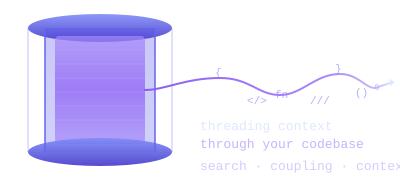

<p align="center"></p>
<p align="center"></p>
<h1 align="center">bobbin</h1>
<p align="center"><em>🧶 Find the code your next change needs.</em></p>
<p align="center">
  <a href="LICENSE"></a>
  <a href="https://github.com/scbrown/bobbin/actions/workflows/ci.yml"></a>
  <a href="https://github.com/scbrown/caboodle"></a>
</p>

[Watch the 60-second context and native hook recording](docs/demos/injection-v0.27.3/README.md).

**Bobbin gives developers and coding agents search and context over their
repositories. Use its command line, Model Context Protocol (MCP) server, or
agent hooks to find code by meaning, search exact words, and discover files
that change together. Local indexing and search need no API key.**

## Why you would want it

- Find relevant functions even when you do not know their names.
- Give your agent a context bundle that fits a line or token budget.
- See related files that imports alone do not reveal, using Git history.

Read [how Bobbin combines these signals](https://scbrown.github.io/bobbin/).

## Install

**Debian and Ubuntu (amd64 and arm64):** install from the signed apt repository, which
republishes each checksum-verified release. The package puts `bobbin` in
`/usr/bin`. Check the signing key's fingerprint before trusting it; the
commands stop if it does not match:

```bash
curl -fsSL https://scbrown.github.io/apt/key.gpg -o scbrown-stack.gpg
gpg --show-keys --with-colons scbrown-stack.gpg \
  | grep -qx 'fpr:::::::::AB5625C5612F643BF76464DF0DC99924994EC959:' \
  && sudo install -D -m 0644 scbrown-stack.gpg /etc/apt/keyrings/scbrown-stack.gpg \
  && echo "deb [signed-by=/etc/apt/keyrings/scbrown-stack.gpg] https://scbrown.github.io/apt stable main" \
     | sudo tee /etc/apt/sources.list.d/scbrown-stack.list \
  && sudo apt update && sudo apt install bobbin
```

`apt upgrade` then picks up new releases. unattended-upgrades only installs
from origins it allows, so to have it upgrade bobbin too, add
`"origin=scbrown,codename=stable";` to `Unattended-Upgrade::Origins-Pattern`.
Channels, pinning and rollback:
[scbrown/apt](https://github.com/scbrown/apt#channels-and-pinning).

Checksummed releases support Linux and macOS on x86-64 and ARM64. For Linux
x86-64, with `curl`, `tar` and `sha256sum` installed:

```bash
mkdir -p bobbin-download && cd bobbin-download
base=https://github.com/scbrown/bobbin/releases/download/v0.26.0
asset=bobbin-v0.26.0-x86_64-unknown-linux-gnu.tar.gz
curl -fLO "$base/$asset" && curl -fLO "$base/SHA256SUMS.txt"
sha256sum --check --ignore-missing SHA256SUMS.txt && tar xzf "$asset"
export PATH="$PWD/bobbin-v0.26.0-x86_64-unknown-linux-gnu:$PATH"
bobbin --version
```

Keep the extracted directory intact: its `lib/` contains ONNX Runtime.
The pinned release reports:

```text
bobbin 0.26.0 (58f4726fe4973240966704bbc9fe171c5ddb3e9a)
```

For [other platforms and runtime prerequisites](https://scbrown.github.io/bobbin/getting-started/installation.html),
use the matching release asset. With the Rust build prerequisites installed,
`cargo install bobbin-ai --locked` builds from source and installs `bobbin`.
Run `bobbin --version`; if it reports an older version, check `command -v bobbin`
for another installation earlier in `PATH`.

## First success in three commands

Run in a shell with Python 3 and Git installed. This creates a disposable project;
initial indexing downloads the embedding model and runs locally on the CPU.

```bash
mkdir -p bobbin-demo && cd bobbin-demo && git init -q && printf 'def greeting(name):\n    return "Hello, " + name\n' > greeting.py
bobbin init --quiet && BOBBIN_GPU=0 bobbin index --quiet --skip-calibrate
bobbin grep greeting --json | python3 -c 'import json,sys; r=json.load(sys.stdin)["results"][0]; print("{}:{}-{}".format(r["name"], r["start_line"], r["end_line"]))'
```

The final command prints:

```text
greeting:1-2
```

Bobbin found a parsed function, with its source range, in the index you just built.
See the [quick start](https://scbrown.github.io/bobbin/getting-started/quick-start.html) for semantic search.

## On your own code

Run `bobbin init` and `bobbin index` from your repository first.

| Question | Command |
|---|---|
| Where is error handling implemented? | `bobbin search "error handling"` |
| What context would help fix login? | `bobbin context "fix the login bug"` |
| Where does an exact name appear? | `bobbin grep greeting` |
| What changes alongside this file? | `bobbin related greeting.py` |
| What is indexed? | `bobbin status` |

See the [CLI reference](https://scbrown.github.io/bobbin/cli/overview.html) for flags and additional commands.

## Wire it into your agent

From the indexed repository, `bobbin serve` starts an MCP server on standard input/output.
Register it by **absolute path**: MCP clients launch servers without your shell's `PATH`,
so a bare `bobbin` fails with `ENOENT`. For Claude Code, from the indexed repository:

```bash
claude mcp add bobbin -- "$(command -v bobbin)" serve "$PWD"
```

Other clients take the same command as JSON (use the output of `command -v bobbin`):

```json
{"mcpServers":{"bobbin":{"command":"/absolute/path/to/bobbin","args":["serve","/path/to/repo"]}}}
```

For automatic Claude Code context injection, run `bobbin hook install` in the
repository; it updates that project's `.claude/settings.json`.
See [agent setup](https://scbrown.github.io/bobbin/getting-started/agent-setup.html) for client configuration
and [hooks](https://scbrown.github.io/bobbin/guides/hooks.html) for gating, deduplication and removal.
Prefer MCP when available, then the CLI; the [HTTP API](https://scbrown.github.io/bobbin/mcp/http-mode.html)
is the transport fallback.

## Before you start

| Requirement | What to expect |
|---|---|
| Platform | Release binaries for Linux and macOS, x86-64 and ARM64 |
| Network | Needed to download releases and the model; local search then uses the cached index |
| Parsing | Rust, TypeScript, Python, Go, Java and C++ use tree-sitter; Markdown has section-aware parsing; other text uses line chunks |
| Git | Commit history enables temporal coupling; a new repository has none yet |
| GPU | Optional; CPU indexing works without CUDA |
| Knowledge graph | Optional Quipu integration requires a build with the `knowledge` feature |

See [installation](https://scbrown.github.io/bobbin/getting-started/installation.html) for system libraries
and source-build requirements, and [language support](https://scbrown.github.io/bobbin/architecture/languages.html).

## What's next

- [Read the Bobbin book](https://scbrown.github.io/bobbin/).
- [Find every document in the docs map](https://scbrown.github.io/bobbin/docs-map.html).
- [Build useful context for a task](https://scbrown.github.io/bobbin/guides/context-assembly.html).

## 🧺 The stack

Caboodle installs these together and proves each one works; every tool also stands alone.

<!-- stack-table:start -->

The Quipu stack is built around a governed, bitemporal knowledge store: shared
facts, decisions and work history your agents can query. Quipu can check writes
against your rules, records where each fact came from, and answers what was true
when.

| tool | what it gives your agents |
|---|---|
| [caboodle](https://github.com/scbrown/caboodle) | 🧰 Agent Platform Toolkit - installs and configures the quipu stack |
| [quipu](https://github.com/scbrown/quipu) | stores shared facts with provenance and history; can check writes against your rules |
| [camayoc](https://github.com/scbrown/camayoc) | prepares knowledge and vocabulary for Quipu, with checks before it is admitted |
| [bobbin](https://github.com/scbrown/bobbin) | searches your code and can include related knowledge from Quipu |
| [yupana](https://github.com/scbrown/yupana) | shows code impact and can read policies from Quipu to check changes |
| [desire-path](https://github.com/scbrown/desire-path) | turns agent mistakes into feature requests; works on its own without Quipu |
| [seeds](https://github.com/scbrown/seeds) | a work item tracker backed by the Quipu knowledge base |
| [shantytown](https://github.com/scbrown/shantytown) | runs crews of AI agents on work items, triggered by hand, on a schedule or by events; can share work and memory through Quipu |
| [shuttle](https://github.com/scbrown/shuttle) | runs signed agent workflows and keeps their records in Quipu |

<!-- stack-table:end -->

## Contributing

```bash
just build
just test
just check
```

See [CONTRIBUTING.md](CONTRIBUTING.md) for prerequisites and documentation checks.

## 📜 License

[Apache License, Version 2.0](LICENSE). Releases before 2026-09-24 were MIT-licensed.
